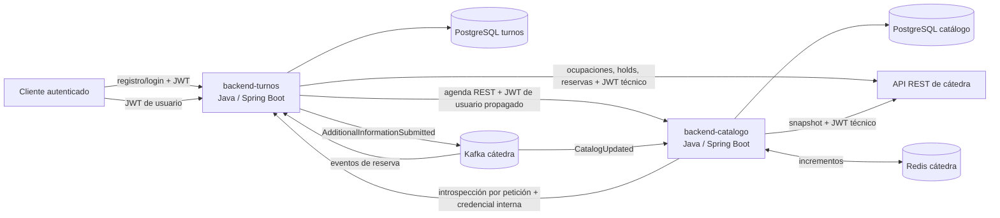
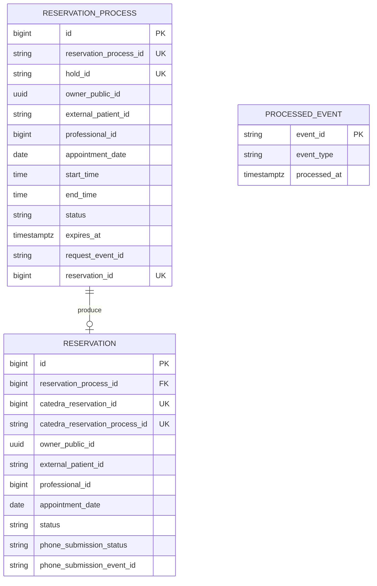

# Arquitectura backend: turnos y reservas

## Contexto y dependencias



Los servicios tienen bases y migraciones Flyway separadas. Turnos nunca consulta tablas del
catálogo: valida agenda vigente por el contrato HTTP interno de `backend-catalogo`. Redis/Kafka
de catálogo y los REST/Kafka de turnos son infraestructura central de la cátedra, no contenedores
locales. Las rutas y esquemas externos se definen en `INTEGRATION_REFERENCE-v2.md` del material
del proyecto. Para ejecución conjunta local, los dos Compose comparten la red externa
`backend-integration` (crear una vez con `docker network create backend-integration`); desde
turnos, catálogo se resuelve por `http://backend-catalogo:8081`.

## Propiedad y modelo de datos

Este servicio es propietario de `jhi_user`, `jhi_authority`, `jhi_user_authority`,
`reservation_process`, `reservation` y `processed_event`. El alta, login y emisión del JWT viven
acá; la base de Catálogo ya no es fuente de credenciales.
`professional_id` referencia un ID externo, no una FK a la base Catálogo. La reserva conserva
atributos descriptivos históricos, pero el catálogo vigente siempre se consulta por HTTP.



Las reservas asociadas a una cuenta técnica de cátedra compartida quedan aisladas localmente
por `owner_public_id` (UUID `publicId` del usuario). Los repositorios consultan/actualizan por
propietario y las APIs no aceptan un `externalPatientId` arbitrario del cliente.

## Contrato con catálogo

Turnos consulta `CATALOGO_API_BASE_URL` antes de crear disponibilidad o una reserva, enviando el
JWT de usuario autenticado en `Authorization`. Catálogo delega la comprobación del token a
`POST /api/internal/auth/introspect` de Turnos antes de procesar cada petición protegida.

| Petición | DTO esperado | Uso |
|---|---|---|
| `GET /api/internal/professionals/{id}` | `{id, categoryId, firstName, lastName, enabled}` | Valida existencia/estado y obtiene datos descriptivos históricos. |
| `GET /api/internal/professionals/{id}/weekly-schedules?date=yyyy-MM-dd` | Lista de `{dayOfWeek, startTime, endTime, slotDurationMinutes}` | Construye slots para la fecha. |

Un `401` del catálogo se traduce a `CATALOG_AUTH_FAILED`, `403` a `CATALOG_ACCESS_DENIED`,
`404` conserva `PROFESSIONAL_NOT_FOUND`, errores de red/`5xx` son `503 CATALOG_UNAVAILABLE` y
respuestas incompatibles son `502 CATALOG_INVALID_RESPONSE`. Sin agenda vigente no se inicia una
reserva.

## Flujo de reservas, estado e idempotencia

1. Construye slots a partir de agenda del catálogo, zona horaria y ocupaciones actuales de
   cátedra (`CONFIRMED`/`HELD`). Un hold local no extiende el TTL remoto.
2. Persiste el proceso y crea el hold mediante REST. Después de la confirmación inicial REST,
   espera el evento `AdditionalInformationRequested`.
3. El teléfono se normaliza/valida y se publica como `AdditionalInformationSubmitted` con un
   `eventId` nuevo y `requestEventId` de la solicitud recibida.
4. Los resultados Kafka se aplican a una máquina de estados persistida. Cada `eventId` se
   procesa una sola vez; un proceso final no se reabre por eventos tardíos. El offset se
   confirma solo después de persistir.
5. Ante una respuesta ambigua de REST, primero reconcilia por identificadores ya guardados; no
   repite ciegamente operaciones con efectos. El scheduler recupera procesos pendientes tras
   reinicios y cierra los vencidos consultando el estado remoto.
6. Los listados remotos se filtran y sincronizan con el propietario local; cancelar y consultar
   exigen que el usuario autenticado sea dueño. La cancelación repetida es idempotente.

Las APIs consumidas por el cliente final están bajo `/api`: disponibilidad
`GET /api/professionals/{id}/availability`, creación `POST /api/reservations`, confirmación
`POST /api/reservations/{processId}/confirm`, envío de teléfono `POST .../phone`, consulta de
proceso y listado en `GET /api/reservations`, y cancelación en `POST .../cancel`. Todas exigen
JWT de usuario con `ROLE_USER`; el detalle de bodies y respuestas está en este README.

## Identidades y seguridad

- Turnos es dueño de las cuentas y emite el JWT HS256 con issuer `backend-turnos`. Valida firma,
  vigencia, `publicId` UUID y autoridad localmente. Catálogo no conoce la clave de firma: llama
  a su endpoint de introspección en cada petición protegida usando credenciales internas Basic
  configuradas como `APP_AUTH_INTROSPECTION_CLIENT_ID/SECRET` (mismos valores en ambos servicios).
  Si Turnos no está disponible, Catálogo falla cerrado y no autoriza la petición.
- Registro, login y perfil son `POST /api/register`, `POST /api/authenticate` y `GET /api/account`
  bajo backend-turnos. Para migrar usuarios existentes, exportar/importar `jhi_user` y
  `jhi_user_authority` antes de cambiar los clientes; la migración `V5` crea el esquema destino.
  No copiar la fila `jhi_authority`, porque el rol `ROLE_USER` ya está sembrado en Turnos.
- El JWT técnico de cátedra se obtiene usando la cuenta técnica del proyecto y se usa solo para
  REST de cátedra. Nunca se reenvía al cliente final. Kafka/Redis usan la configuración asignada
  a esa cuenta técnica.
- `.env` contiene configuración local y está ignorado por Git. Los secretos no se ponen en
  imágenes, logs ni respuestas. El servicio usa timeouts y reintentos acotados para llamadas
  REST de cátedra.
- Los Compose locales ligan HTTP/PostgreSQL a `127.0.0.1`. Producción requiere TLS en ingress,
  servicios y bases en red privada, y HTTPS para llamadas inter-servicio. La configuración de
  cabeceras forwarded solo debe confiar en un proxy controlado.
- CORS se limita a `CORS_ALLOWED_ORIGINS`; la lista vacía no autoriza clientes web.

## Kafka y recuperación del listener

La integración se vuelve a consultar en el arranque y luego cada
`APP_KAFKA_LISTENER_RECOVERY_FIXED_DELAY_MS` milisegundos (30 s por defecto) hasta que esté
provisionada. Un contenedor detenido por error se recrea en el siguiente ciclo. El evento
fallido no se confirma; tras recrear el consumidor, Kafka puede entregarlo otra vez y la
deduplicación persistida evita repetir efectos ya aplicados. El cliente Kafka mantiene sus
reconexiones de red mientras el contenedor siga activo.

## Pruebas

```bash
./mvnw test
```

Testcontainers requiere Docker para PostgreSQL. Las pruebas cubren seguridad JWT, disponibilidad,
flujo de reserva, ownership, idempotencia Kafka, conciliación y recuperación del listener tras
una indisponibilidad inicial o una detención.
